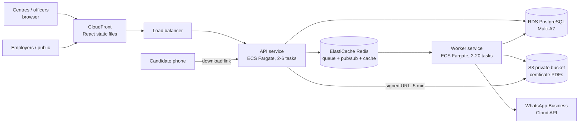

# Deployment plan

**Load to plan for**
- 100,000 registered users, about 10,000 daily active.
- Results day peak: 500 batches approved in one hour, which means about **30,000 PDFs and 30,000 WhatsApp messages** in that hour.
- Public checks: thousands a day, arriving in bursts.

**Choice:** AWS, Mumbai region (ap-south-1). Data about Indian citizens stays in India, and latency to users is low. Managed services wherever possible, so a small team doesn't have to run databases.

## 1. Architecture

**Event flow:** state approval is saved in Postgres → one job per candidate goes on the Redis queue → workers make the PDF, upload it to S3, send it on WhatsApp → each step writes to Postgres and publishes a "changed" event on Redis → every API task pushes it to connected browsers (SSE).

## 2. Where each part runs, and why

| Part | Hosted on | Why |
|---|---|---|
| React app | S3 + CloudFront | Static files; cheap and fast; no servers. |
| API | ECS Fargate behind an Application Load Balancer | Containers we already have; no servers to patch; scales by task count. Stateless, so any task can serve any request. |
| Worker | ECS Fargate (separate service) | Scales separately from the API, based on queue length. |
| PostgreSQL | RDS PostgreSQL, Multi-AZ, with RDS Proxy | Automatic failover, backups, point-in-time restore. The proxy pools connections when many tasks start. |
| Redis | ElastiCache Redis with a replica, Multi-AZ | Managed failover. |
| PDFs | S3 private bucket | Durable and cheap. Never public. |
| Secrets | AWS Secrets Manager | JWT secret, DB password, WhatsApp token never live in code. |

## 3. Scaling

**What scales sideways (more copies):** API tasks (on CPU / request count) and worker tasks (on queue length). Nothing is stored in a task's memory, so copies can be added or removed at any time.

**Peak maths (results day):**
- 30,000 certificates in 1 hour is about **8.3 per second**.
- One PDF takes roughly 100-200 ms of CPU, so about 2 vCPUs keep up. We plan for **10-20 worker tasks** (concurrency 10 each) to absorb spikes and slow WhatsApp replies.
- The WhatsApp Cloud API allows about 80 messages per second per business number by default (check Meta's current limits). 8.3/s is well inside that.
- Database: about 6 writes per certificate is about 50 writes/s. Small for RDS. The real risk is too many connections, which RDS Proxy handles.

**What limits throughput at peak:** in order, (1) WhatsApp rate limits and its error rate, (2) database connections, (3) PDF CPU.

**How the backlog clears:** approvals always succeed immediately; certificates queue up in Redis. Autoscaling adds workers when queue length rises (for example, 1 worker per 500 waiting jobs, up to 20). Workers respect WhatsApp's rate limit with a BullMQ rate limiter. Even at worst case the queue drains steadily, and the state office can see progress (queue panel).

**Public checks in bursts:** answered from the Redis cache (30 s), rate-limited per IP, and served by the same stateless API tasks. The cache is short and deleted on cancel, so a cancelled certificate never shows as valid.

## 4. Failure handling

| Failure | What happens | Why it's safe |
|---|---|---|
| **Worker crashes mid-job** | BullMQ marks the job "stalled" and gives it to another worker. | Every step is safe to repeat: one certificate per candidate (unique rule), same PDF file, same WhatsApp idempotency key. No duplicates. |
| **Redis restarts** | Queue data persists (AOF on, plus ElastiCache replica failover). API requests that need Redis (cache, rate limit) fall back to the database. | Postgres is the source of truth. The sweep job re-queues every approved candidate without a delivered certificate, so nothing is lost even if queue data is. |
| **WhatsApp outage** | Jobs retry with growing waits (2 s → 32 s). After all retries, the certificate is marked FAILED and the sweep job keeps re-queuing it every 30 s. An alarm fires when the failure rate is high. | Messages are sent when WhatsApp comes back. Candidates are never sent two messages, thanks to idempotency keys. |
| **Slow database** | Queries have timeouts; the API returns a clear error quickly instead of hanging; workers slow down and retry. | Locks and unique rules mean retries can't double anything. Next steps if it persists: bigger instance, read replica for public checks. |
| **API task dies** | The load balancer stops sending it traffic; ECS starts a new one. Browsers' live-update streams reconnect automatically. | No state in the task. |

## 5. Certificate files and access control

- Stored in a **private S3 bucket**, encrypted, key = certificate id. Not listable, not public.
- The candidate's WhatsApp link points to our API with a **64-character random token**. The API checks the certificate is still valid, then redirects to an **S3 signed URL that expires in 5 minutes**.
- Cancelled certificate → the link returns "cancelled" (410).
- Officers and the state office see certificate details in the app only through role-checked API calls.
- S3 versioning + lifecycle rule moves old files to cheaper storage after 1 year.

## 6. Monitoring and alerting

- **Logs:** JSON logs (pino) to CloudWatch, with a request id on every line, so one request can be followed through the API.
- **History:** the audit log answers "what happened to this batch / certificate?" (`GET /api/trace/:id`).
- **Metrics (dashboard):** queue waiting / active / failed counts, certificates delivered per minute, WhatsApp error rate, time from approval to delivery (p95), API latency (p95) and 5xx rate, stuck batches, DB connections and CPU.
- **Alerts (to on-call by SMS / email):**
  - queue waiting > 5,000 for 10 min
  - WhatsApp failure rate > 20% for 5 min
  - any certificate FAILED for more than 1 hour
  - API 5xx > 2%
  - DB CPU > 80% for 10 min
  - Redis or DB failover event

## 7. Rough monthly cost (approximate, on-demand prices; check the AWS pricing calculator)

| Item | Approx. USD / month |
|---|---|
| API: 2 Fargate tasks (0.5 vCPU, 1 GB), always on | 35 |
| Workers: 2 tasks always on + peak bursts | 45 |
| RDS PostgreSQL db.t4g.medium, Multi-AZ, 50 GB | 130 |
| ElastiCache Redis small, with replica | 50 |
| Load balancer | 25 |
| NAT gateway | 40 |
| S3 + CloudFront | 5 |
| CloudWatch logs, metrics, alarms | 20 |
| **Total** | **about 350 (roughly ₹30,000)** |

On top of this come **WhatsApp message fees**, charged by Meta per message. At about 8,000 certificates a month normally, plus results-day peaks, these may cost as much as the infrastructure. Check Meta's current rate card for India.

**Trade-offs**
- Multi-AZ database and Redis roughly double their cost. We accept that: certificates are official documents, and an outage on results day is the worst case.
- Fargate costs more per CPU than EC2, but needs no server management. A small team matters more than a few dollars.
- Workers scale down to 2 outside peaks, so the results-day spike costs only a few hours of extra tasks.
- Not chosen: Kafka/RabbitMQ (more to run; BullMQ on Redis covers this load). Kubernetes (too much operations work for one service pair).
